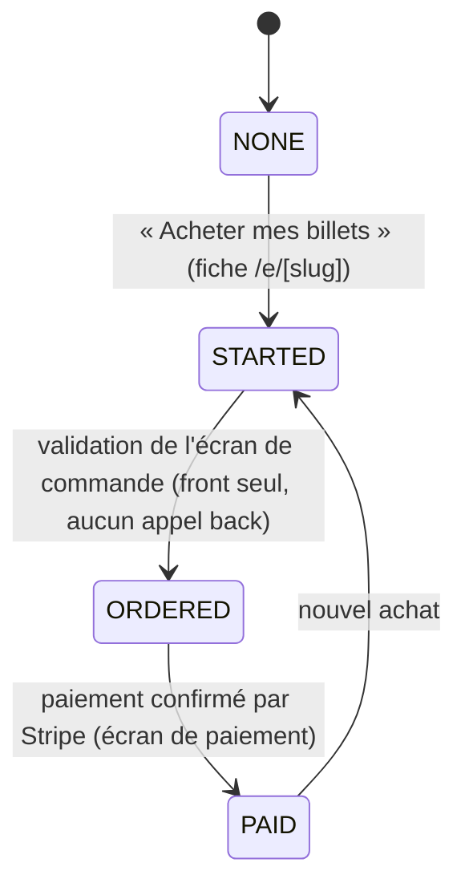
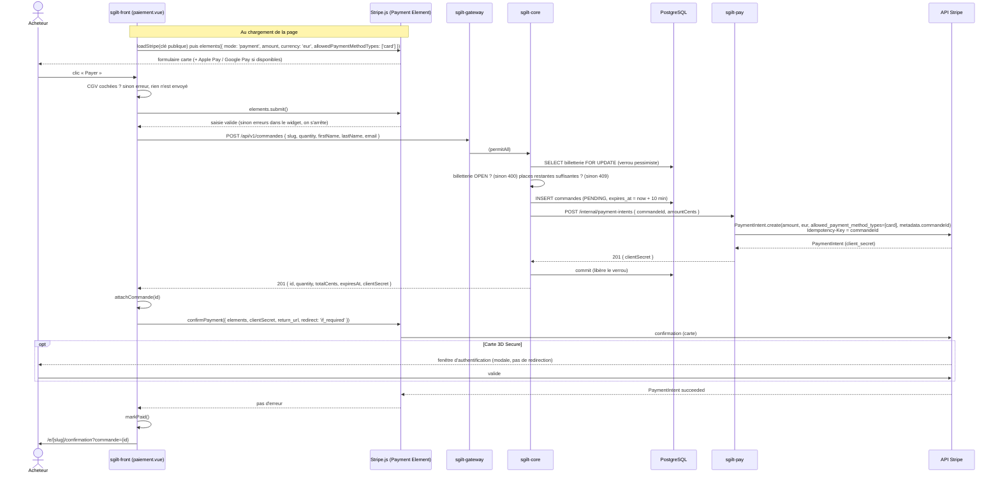
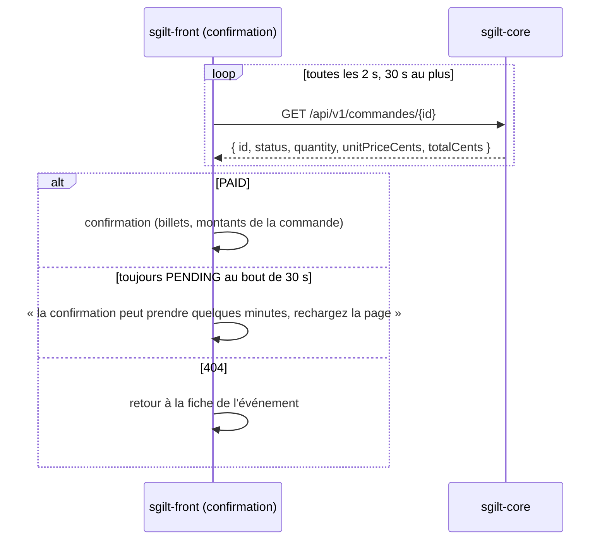
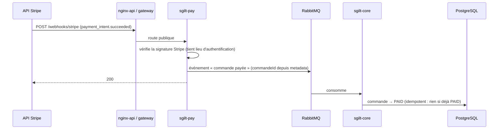

# Billetterie — flow technique du paiement

> Documentation technique de l'achat de billets d'un événement public (`/e/[slug]`), du clic sur
> « Acheter mes billets » jusqu'à la confirmation. Le paiement passe par Stripe, derrière le
> service `sgilt-pay`.

## Vue d'ensemble

| Brique | Contenu                                                                                   | État                  |
|--------|-------------------------------------------------------------------------------------------|-----------------------|
| 5      | Création de la commande côté back (`POST /api/v1/commandes`), blocage des places          | Fait                  |
| 1a     | `sgilt-pay` crée le PaymentIntent Stripe, le core renvoie son secret client au front      | Fait (2026-10-31)     |
| 1b     | Payment Element Stripe dans l'écran de paiement, confirmation du paiement depuis le front | Fait (2026-10-31)     |
| 2      | Webhook Stripe → `sgilt-pay` → RabbitMQ (queue `payment.succeeded`) → le core passe la commande `PAID` | Réception (2a), passage `PAID` (2b) et alerte de survente par e-mail à l'équipe Sgilt (2c) faits |
| 3      | `GET /commandes/{id}` et écran de confirmation sans état front                            | Fait (2026-11-01)     |

Composants :

| Composant       | Rôle                                                                                                       |
|-----------------|------------------------------------------------------------------------------------------------------------|
| `sgilt-front`   | Parcours d'achat (`/e/[slug]/commande`, `/paiement`, `/confirmation`, tous en `ssr: false`), widget Stripe |
| `sgilt-gateway` | Route publique `/api/v1/commandes/**` (`permitAll` : on achète sans compte)                                |
| `sgilt-core`    | Commandes, blocage des places, appel à `sgilt-pay`                                                         |
| `sgilt-pay`     | Seul service à parler à Stripe (clé secrète). Port 5032, réseau interne, sans base                         |
| Stripe          | PaymentIntents API, Payment Element (Stripe.js), webhooks                                                  |

---

## Parcours d'achat côté front

Le brouillon de commande (événement, quantité, acheteur, étape) vit dans le sessionStorage
(`useTicketOrder`) : il survit au rechargement, pas à la fermeture de l'onglet. Le middleware
`ticketing` n'ouvre chaque écran qu'à son étape.



| Écran                     | Ouvert si                                               |
|---------------------------|---------------------------------------------------------|
| `/e/[slug]/commande`      | billetterie achetable **et** étape `STARTED` ou `ORDERED` |
| `/e/[slug]/paiement`      | billetterie achetable **et** étape `ORDERED`            |
| `/e/[slug]/confirmation`  | `?commande={id}` dans l'URL, quelle que soit l'étape (même si l'événement est devenu complet) |

L'écran de commande ne crée rien côté back : la commande n'existe qu'au clic sur « Payer ».

---

## Séquence du paiement (briques 5, 1a, 1b)

Le Payment Element est monté **sans PaymentIntent** (mode différé : montant, devise, moyens de
paiement). Le PaymentIntent n'est créé qu'au clic sur « Payer », en même temps que la commande.



### Écran de confirmation (brique 3)

Le statut vient du back, pas du sessionStorage : l'URL suffit, même au retour d'une redirection
(`return_url`) ou dans un autre onglet. Stripe confirme le paiement au front avant le webhook : la
commande peut encore être `PENDING` à l'arrivée sur l'écran.



Une erreur passagère (réseau, 5xx) ne coupe pas l'attente.

### Points clés

- **Le verrou de la billetterie** (`BilletterieService.lockOpenBilletterie`, `PESSIMISTIC_WRITE`)
  sérialise les acheteurs d'un même événement : le décompte des places et l'insertion de la
  commande sont atomiques. Il est tenu pendant l'appel à Stripe (environ 1 s).
- **Échec de `sgilt-pay`** (Stripe indisponible, clé invalide) : `sgilt-pay` répond 502, l'appel
  du core lève une exception, la transaction est annulée. Aucune commande ne reste sans
  PaymentIntent.
- **Idempotence** : la clé d'idempotence Stripe est l'id de la commande. Un second appel pour la
  même commande renvoie le même PaymentIntent.
- **Le secret client** n'est pas stocké : il n'est que dans la réponse du `POST`, le front s'en
  sert une fois pour confirmer le paiement.
- **Moyens de paiement** : carte uniquement, Apple Pay et Google Pay en découlent (sur les
  appareils compatibles, en HTTPS, sur un domaine déclaré chez Stripe). Même liste côté front
  (`allowedPaymentMethodTypes`) et côté `sgilt-pay` (`allowed_payment_method_types`). Link est
  exclu (il redemandait les coordonnées déjà saisies) et masqué explicitement dans le widget
  (`wallets: { link: 'never' }`). Pas de moyen de paiement différé (SEPA…) ni à redirection
  (PayPal…) pour l'instant.

### Cas d'erreur

| Cas                                   | Où                     | Ce que voit l'acheteur                                         | Commande                       |
|---------------------------------------|------------------------|----------------------------------------------------------------|--------------------------------|
| CGV non cochées                       | front                  | erreur sous la case                                            | aucune                         |
| Saisie carte invalide                 | `elements.submit()`    | erreurs dans le widget + message Stripe sous le bouton         | aucune                         |
| Plus assez de places                  | core, 409              | « Il ne reste plus assez de places… »                          | aucune                         |
| Billetterie fermée / introuvable      | core, 400 / 404        | « La billetterie de cet événement n'est plus ouverte. »        | aucune                         |
| Core ou `sgilt-pay` en erreur         | 5xx                    | « Une erreur est survenue, merci de réessayer. »               | aucune (rollback)              |
| Carte refusée                         | `confirmPayment`       | message Stripe (en français) sous le bouton                    | reste `PENDING`                |
| 3D Secure échoué                      | `confirmPayment`       | message générique                                              | reste `PENDING`                |

Après un refus, un nouvel essai crée une **nouvelle** commande (et un nouveau PaymentIntent).
L'ancienne garde ses places jusqu'à son expiration.

---

## Blocage des places

```
places restantes = capacité − Σ quantité (PAID) − Σ quantité (PENDING et expires_at > now)   (minimum 0)
```

- Une commande `PENDING` bloque ses places **10 minutes** (`CommandeService.COMMANDE_HOLD_DURATION`).
- Au-delà, elle ne compte plus : ses places se libèrent d'elles-mêmes, sans tâche planifiée. La
  commande reste `PENDING` en base.
- **Paiement arrivé après l'expiration** (acheteur lent, 3D Secure long) : la commande passe
  `PAID` quand même, le paiement a eu lieu. Si ses places ont été reprises entre-temps, la jauge
  est dépassée (survente, rarissime) : pas de remboursement automatique, un warn dans les logs et
  un e-mail d'alerte à l'équipe Sgilt (`AdminMailerService.sendOversoldAlert`, adresse
  `ADMIN_EMAIL`), qui décide : rembourser depuis le dashboard Stripe, ou accepter la survente.
- Statuts (`commande_status`) : `PENDING`, `PAID`, `CANCELLED`. **`CANCELLED` n'est produit par
  aucun code aujourd'hui** : il est réservé (annulation, libération anticipée).

---

## À venir

### Brique 2 — webhook



- Seule route de `sgilt-pay` exposée publiquement. En local, `stripe listen --forward-to
  localhost:5032/...` fait le pont depuis Stripe.
- Libération anticipée des places : `payment_intent.payment_failed` n'est pas un abandon (l'acheteur
  peut réessayer sur le même PaymentIntent) et l'abandon n'émet aucun événement. Libérer plus tôt
  voudra dire annuler nous-mêmes le PaymentIntent (commande remplacée par un nouvel essai, ou
  expirée), et passer la commande `CANCELLED`.

---

## Configuration

| Variable                              | Service       | Local                                                       | Staging / prod                         |
|---------------------------------------|---------------|-------------------------------------------------------------|----------------------------------------|
| `PAY_URL`                             | `sgilt-core`  | défaut `http://localhost:5032`                              | `http://sgilt-pay-${ENV}:5032`         |
| `STRIPE_SECRET_KEY`                   | `sgilt-pay`   | `application-local-secrets.yml` (gitignoré, profil `local`) | variable d'environnement               |
| `STRIPE_WEBHOOK_SECRET`               | `sgilt-pay`   | `application-local-secrets.yml`, secret de `stripe listen` (conteneur `sgilt-stripe-cli`) | secret de l'endpoint déclaré dans le dashboard |
| `NUXT_PUBLIC_STRIPE_PUBLISHABLE_KEY`  | `sgilt-front` | `sgilt-front/.env` (relancer `npm run dev` après modif)     | variable d'environnement               |
| `ADMIN_EMAIL`                         | `sgilt-core`  | `admin@sgilt.local` (`application-local.yml`, arrive dans MailHog) | secret GitHub, propre à l'environnement, sans défaut |

- Clés `sk_test` / `pk_test` en local et en staging ; clés live seulement après activation du
  compte Stripe.
- Avant la prod : déclarer le domaine pour Apple Pay, libellé de relevé bancaire, intégrer
  `sgilt-pay` aux docker-compose et à la CI de déploiement.
- Staging garde des clés de test en permanence, sur une sandbox Stripe dédiée (séparée de celle du
  poste de dev, pour que les webhooks ne se mélangent pas).

### Sécurité (avant la prod)

- **Anti-abus sur `POST /api/v1/commandes`** : l'endpoint est public et sans limite, n'importe qui
  peut bloquer toutes les places 10 minutes sans payer (la quantité n'est contrôlée que par
  `@Positive`) et créer des PaymentIntents en masse. À faire :
  - limite de requêtes par IP dans la gateway, sur le modèle d'`InitOnboardingRateLimitFilter`
    (IP réelle via `X-Real-IP`) ;
  - plafond de quantité par commande (ex. 10 billets), côté core et côté front.

- **Clé restreinte** : en prod, `STRIPE_SECRET_KEY` reçoit une clé restreinte (`rk_live_…`) limitée
  aux PaymentIntents (écriture) et à ce que lit le webhook, plutôt que la clé secrète complète. Une
  fuite ne permet alors ni remboursement ni lecture des clients.
- **Réseau Docker dédié au paiement** : les services existants gardent leur réseau à plat
  (`sgilt-network-${ENV}`) ; un second réseau `payment` relie :
  - `sgilt-pay`, branché **uniquement** sur `payment` ;
  - `sgilt-core`, sur les deux réseaux (création des PaymentIntents) ;
  - `sgilt-gateway`, sur les deux réseaux, uniquement pour faire suivre `/webhooks/stripe` (liste
    blanche : jamais `/internal/...`).

  `/internal/payment-intents` n'a pas d'authentification : seuls le core et la gateway peuvent
  l'atteindre. Le webhook est protégé par la signature Stripe (secret `whsec_…` en variable
  d'environnement, horodatage contre le rejeu) et le passage `PAID` est idempotent.

### Cartes de test

| Carte                 | Résultat                       |
|-----------------------|--------------------------------|
| `4242 4242 4242 4242` | succès direct                  |
| `4000 0025 0000 3155` | 3D Secure (valider ou échouer) |
| `4000 0000 0000 0002` | refusée                        |

Date future quelconque, CVC quelconque.
