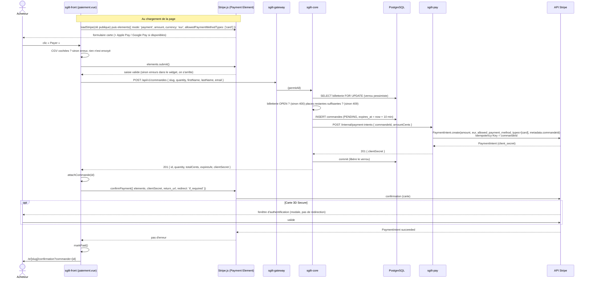
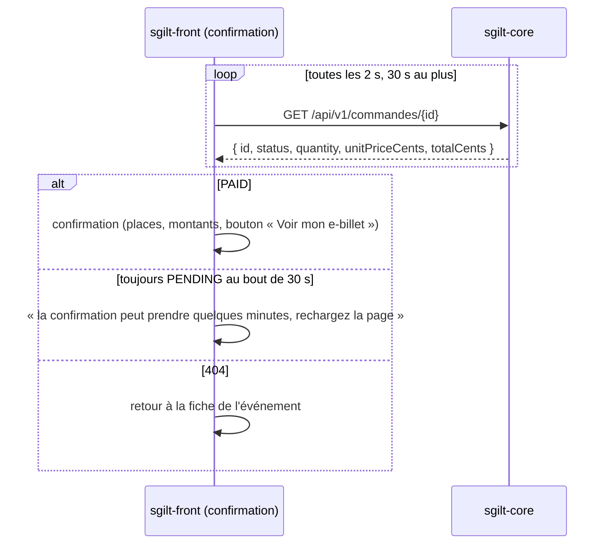
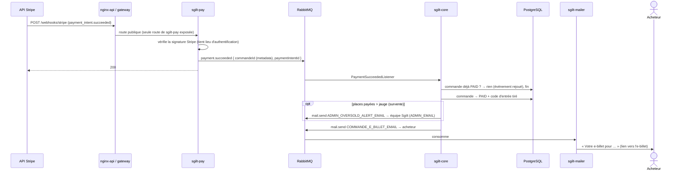

# Billetterie — flow technique de l'achat

> Documentation technique de l'achat de places pour un événement public (`/e/[slug]`), du clic
> sur « Réserver mes places » jusqu'à l'e-billet. Le paiement passe par Stripe, derrière le
> service `sgilt-pay`.
>
> Vocabulaire : on achète des **places** (ce que compte la jauge) ; une commande payée donne **un
> e-billet** (un seul QR code, valable pour toutes ses places).

## Vue d'ensemble

| Brique | Contenu                                                                                   | État                  |
|--------|-------------------------------------------------------------------------------------------|-----------------------|
| 5      | Création de la commande côté back (`POST /api/v1/commandes`), blocage des places          | Fait                  |
| 1a     | `sgilt-pay` crée le PaymentIntent Stripe, le core renvoie son secret client au front      | Fait (2026-10-31)     |
| 1b     | Payment Element Stripe dans l'écran de paiement, confirmation du paiement depuis le front | Fait (2026-10-31)     |
| 2      | Webhook Stripe → `sgilt-pay` → RabbitMQ (queue `payment.succeeded`) → le core passe la commande `PAID`, alerte de survente à l'équipe Sgilt | Fait (2026-11-02)     |
| 3      | `GET /commandes/{id}` et écran de confirmation sans état front                            | Fait (2026-11-01)     |
| —      | Anti-abus : limite de débit par IP (gateway), plafond de 10 places par commande           | Fait (2026-11-03/04)  |
| —      | E-billet : code d'entrée au passage `PAID`, `GET /commandes/{id}/e-billet`, page « Mon e-billet » avec QR | Fait (2026-11-03)     |
| —      | E-mail à l'acheteur au passage `PAID`, avec le lien vers son e-billet                     | Fait (2026-11-03)     |
| —      | E-billet en PDF (`GET /commandes/{id}/e-billet.pdf`, bouton sur la page) ; QR dessiné par le back pour la page et le PDF | Fait (2026-11-08)     |
| —      | Interrupteurs BO (page publique, billetterie) ; page publique administrée par l'organisateur dans son board (contenu, publication, billetterie, ventes, aperçu) | Fait (2026-11-05/06)  |
| —      | Horaires de l'événement dans Paramètres (`PUT /user/events/{id}/horaires`), pour tous les événements | Fait (2026-11-06)     |

Composants :

| Composant       | Rôle                                                                                                       |
|-----------------|------------------------------------------------------------------------------------------------------------|
| `sgilt-front`   | Parcours d'achat (`/e/[slug]/commande`, `/paiement`, `/confirmation`, `/e-billet`, tous en `ssr: false`), widget Stripe, affichage du QR |
| `sgilt-gateway` | Routes publiques `/api/v1/commandes/**` (`permitAll` : on achète sans compte) et `/webhooks/stripe`, limite de débit par IP |
| `sgilt-core`    | Commandes, blocage des places, appel à `sgilt-pay`, passage `PAID`, code d'entrée, e-billet (QR, PDF), e-mails |
| `sgilt-pay`     | Seul service à parler à Stripe (clé secrète). Port 5032, réseau interne, sans base                         |
| RabbitMQ        | `payment.succeeded` (`sgilt-pay` → core), `mail.send` (core → `sgilt-mailer`)                              |
| `sgilt-mailer`  | E-mail d'e-billet à l'acheteur, alerte de survente à l'équipe Sgilt                                        |
| Stripe          | PaymentIntents API, Payment Element (Stripe.js), webhooks                                                  |

---

## Parcours d'achat côté front

Le brouillon de commande (événement, quantité, acheteur, étape) vit dans le sessionStorage
(`useTicketOrder`) : il survit au rechargement, pas à la fermeture de l'onglet. Le middleware
`ticketing` n'ouvre chaque écran qu'à son étape.


| Écran                     | Ouvert si                                               |
|---------------------------|---------------------------------------------------------|
| `/e/[slug]/commande`      | billetterie achetable **et** étape `STARTED` ou `ORDERED` |
| `/e/[slug]/paiement`      | billetterie achetable **et** étape `ORDERED`            |
| `/e/[slug]/confirmation`  | `?commande={id}` dans l'URL, quelle que soit l'étape (même si l'événement est devenu complet) |
| `/e/[slug]/e-billet`      | `?commande={id}` dans l'URL, même règle ; une commande inconnue ou pas payée renvoie à la fiche |

L'écran de commande ne crée rien côté back : la commande n'existe qu'au clic sur « Payer ».

---

## Séquence du paiement (briques 5, 1a, 1b)

Le Payment Element est monté **sans PaymentIntent** (mode différé : montant, devise, moyens de
paiement). Le PaymentIntent n'est créé qu'au clic sur « Payer », en même temps que la commande.



### Écran de confirmation (brique 3)

Le statut vient du back, pas du sessionStorage : l'URL suffit, même au retour d'une redirection
(`return_url`) ou dans un autre onglet. Stripe confirme le paiement au front avant le webhook : la
commande peut encore être `PENDING` à l'arrivée sur l'écran.



Une erreur passagère (réseau, 5xx) ne coupe pas l'attente.

### Points clés

- **Le verrou de la billetterie** (`BilletterieService.lockOpenBilletterie`, `PESSIMISTIC_WRITE`)
  sérialise les acheteurs d'un même événement : le décompte des places et l'insertion de la
  commande sont atomiques. Il est tenu pendant l'appel à Stripe (environ 1 s).
- **Échec de `sgilt-pay`** (Stripe indisponible, clé invalide) : `sgilt-pay` répond 502, l'appel
  du core lève une exception, la transaction est annulée. Aucune commande ne reste sans
  PaymentIntent.
- **Idempotence** : la clé d'idempotence Stripe est l'id de la commande. Un second appel pour la
  même commande renvoie le même PaymentIntent.
- **Le secret client** n'est pas stocké : il n'est que dans la réponse du `POST`, le front s'en
  sert une fois pour confirmer le paiement.
- **Moyens de paiement** : carte uniquement, Apple Pay et Google Pay en découlent (sur les
  appareils compatibles, en HTTPS, sur un domaine déclaré chez Stripe). Même liste côté front
  (`allowedPaymentMethodTypes`) et côté `sgilt-pay` (`allowed_payment_method_types`). Link est
  exclu (il redemandait les coordonnées déjà saisies) et masqué explicitement dans le widget
  (`wallets: { link: 'never' }`). Pas de moyen de paiement différé (SEPA…) ni à redirection
  (PayPal…) pour l'instant.

### Cas d'erreur

| Cas                                   | Où                     | Ce que voit l'acheteur                                         | Commande                       |
|---------------------------------------|------------------------|----------------------------------------------------------------|--------------------------------|
| CGV non cochées                       | front                  | erreur sous la case                                            | aucune                         |
| Saisie carte invalide                 | `elements.submit()`    | erreurs dans le widget + message Stripe sous le bouton         | aucune                         |
| Plus assez de places                  | core, 409              | « Il ne reste plus assez de places… »                          | aucune                         |
| Plus de 10 places                     | front (core : 400)     | « Vous pouvez réserver jusqu'à 10 places par commande. » au clic sur « + » | aucune               |
| Trop de commandes depuis cette IP     | gateway, 429           | « Trop de tentatives… réessayer dans quelques minutes. »       | aucune                         |
| Billetterie fermée / introuvable / coupée | core, 400 / 404    | « La billetterie de cet événement n'est plus ouverte. »        | aucune                         |
| Core ou `sgilt-pay` en erreur         | 5xx                    | « Une erreur est survenue, merci de réessayer. »               | aucune (rollback)              |
| Carte refusée                         | `confirmPayment`       | message Stripe (en français) sous le bouton                    | reste `PENDING`                |
| 3D Secure échoué                      | `confirmPayment`       | message générique                                              | reste `PENDING`                |

Après un refus, un nouvel essai crée une **nouvelle** commande (et un nouveau PaymentIntent).
L'ancienne garde ses places jusqu'à son expiration.

---

## Blocage des places

```
places restantes = capacité − Σ quantité (PAID) − Σ quantité (PENDING et expires_at > now)   (minimum 0)
```

- Une commande `PENDING` bloque ses places **10 minutes** (`CommandeService.COMMANDE_HOLD_DURATION`).
- Au-delà, elle ne compte plus : ses places se libèrent d'elles-mêmes, sans tâche planifiée. La
  commande reste `PENDING` en base.
- **Paiement arrivé après l'expiration** (acheteur lent, 3D Secure long) : la commande passe
  `PAID` quand même, le paiement a eu lieu. Si ses places ont été reprises entre-temps, la jauge
  est dépassée (survente, rarissime) : pas de remboursement automatique, un warn dans les logs et
  un e-mail d'alerte à l'équipe Sgilt (`AdminMailerService.sendOversoldAlert`, adresse
  `ADMIN_EMAIL`), qui décide : rembourser depuis le dashboard Stripe, ou accepter la survente.
- Statuts (`commande_status`) : `PENDING`, `PAID`, `CANCELLED`. **`CANCELLED` n'est produit par
  aucun code aujourd'hui** : il est réservé (annulation, libération anticipée).

---

## Après le paiement : webhook, passage `PAID`, e-mail (brique 2)



- **Idempotence** : `CommandeService.markPaid` ne renvoie la commande que si elle vient de passer
  `PAID` (`Optional` vide sinon) ; un événement Stripe rejoué ne tire pas de nouveau code et
  n'envoie pas de second e-mail.
- **Orchestration dans le listener** : `PaymentSucceededListener` enchaîne `markPaid`, le slug et
  les infos de l'événement (`PageEvenementService`) puis l'envoi (`CommandeMailerService`).
  `CommandeService` ne peut pas appeler `PageEvenementService` (`BilletterieService` dépend déjà de
  `CommandeService`).
- **E-mail d'e-billet** (`COMMANDE_E_BILLET_EMAIL`) : prénom, titre, « valable pour N
  personne(s) » (accordé par le core), date et horaires (`EventDateLabelUtils`, même rendu que le
  front — doublon assumé), lieu, ville, lien `${PUBLIC_SITE_URL}/e/{slug}/e-billet?commande={id}`.
  Pas de QR ni de PDF dans l'e-mail : ils sont derrière le lien (le texte dit que l'e-billet se
  télécharge en PDF depuis la page).
- **Échec d'envoi** : journalisé, pas relancé ; la commande reste payée. Un événement sans page
  (impossible en pratique) n'envoie rien, avec une erreur dans les logs. Lieu ou ville absents :
  envoyés vides.
- En local, le conteneur `sgilt-stripe-cli` (`stripe listen`) fait le pont depuis Stripe.

---

## E-billet

Une commande payée a **un** e-billet : un seul QR code, présenté à l'entrée, qui fait entrer toutes
ses places.

- **Code d'entrée** : tiré au passage `PAID` (`EntryCodeUtils.newCode`, 128 bits aléatoires,
  base64url sans padding, 22 caractères), colonne `commandes.code` (unique, V124).
- **Contenu du QR** : `SGILT:C:<code>` (préfixe de type, **sans lien**), fabriqué par le back
  (`EntryCodeUtils.commandeQrContent`). Le futur lecteur sera une page Sgilt.
- **Dessin du QR** : par le back seulement (`QrCodeUtils`, ZXing), pour la page comme pour le PDF :
  PNG 512 px, correction d'erreur M, marge de 4 modules, servi en data URI
  (`data:image/png;base64,…`). Le front ne dessine rien (plus de lib `qrcode`) et ne reçoit pas le
  contenu du QR.
- **Route** : `GET /api/v1/commandes/{id}/e-billet` (publique) → `EBilletDto` : titre, image,
  type d'événement (image par défaut côté front), `evenementInfos` (tag et sous-titre de la page,
  date, horaires, lieu, ville, infos pratiques), nombre de places, QR dessiné (`qrImage`). 404 si
  la commande est inconnue **ou pas payée**. Orchestration commande + page dans `EBilletService`.
- **Page** `/e/[slug]/e-billet?commande={id}` : même hero que la fiche (`SgiltHero`), **sans** le
  bouton partager (il partagerait l'URL, donc l'e-billet) ; QR (``, 12rem) ; « Valable pour N
  personne(s) » ; bouton « Télécharger mon e-billet (PDF) » ; infos pratiques ; contact. Commande
  inconnue ou pas payée → fiche ; toute autre erreur → « Réessayer » (l'acheteur est peut-être à
  l'entrée).
- **Accès** : l'id de la commande seul (UUID v4, non devinable), sans compte. L'URL ne doit pas
  fuiter :
  - `X-Robots-Tag: noindex, nofollow, noarchive` (routeRule de `nuxt.config.ts`) — un en-tête, la
    balise meta serait inutile en `ssr: false` ;
  - `Referrer-Policy: no-referrer` sur l'e-billet **et** la confirmation (on passe de l'une à
    l'autre sans recharger : c'est l'en-tête de la confirmation qui s'applique) ;
  - pas de `Disallow` dans `robots.txt` (il empêcherait les moteurs de lire le `noindex`) ; page
    absente du sitemap (route dynamique) et liée nulle part publiquement.
- **Indépendant de la fiche** : le middleware laisse passer l'e-billet avant de charger la fiche ;
  il ne dépend que de la commande. L'acheteur garde son e-billet si la page est dépubliée ou perd
  sa billetterie ; le lien « retour à l'événement » n'apparaît que si la page est en ligne
  (`EBilletDto.pageOnline`).

### PDF

- **Route** : `GET /api/v1/commandes/{id}/e-billet.pdf` (publique, mêmes règles : 404 si inconnue ou
  pas payée) → `application/pdf` en pièce jointe, nommé `e-billet-<slug>.pdf` (`e-billet.pdf` si
  l'événement n'a pas de page). En-têtes `Cache-Control: no-store` et
  `X-Robots-Tag: noindex, nofollow, noarchive`. La gateway la couvre déjà (`/api/v1/commandes/**`).
- **Front** : un simple lien (`<a href>`) vers la route, sans JavaScript : le navigateur télécharge
  grâce au `Content-Disposition`. Possible parce que la route est publique (pas d'en-tête
  `Authorization`, contrairement aux documents du feed des réservations).
- **Contenu** : le même que la page, **sans le nom de l'acheteur** (la route n'est protégée que par
  l'UUID de la commande) ni l'image de l'événement (WebP sur R2 : décodage, redimensionnement et
  appel réseau jugés disproportionnés). A4 portrait : en-tête blanc avec le logo Sgilt en couleurs
  et une ligne d'accent, tag, titre, sous-titre, carte QR (6,5 cm) avec « Valable pour N
  personne(s) », infos pratiques, contact.
- **Génération** : à la volée à chaque demande, **jamais stockée** (le PDF reflète toujours
  l'événement à jour : horaires, lieu). `EBilletPdfService` remplit le gabarit XHTML
  `resources/ebillet/e-billet.html` (valeurs échappées, blocs facultatifs omis s'ils sont vides) et le
  rend avec **openhtmltopdf** (moteur PDFBox, CSS 2.1, LGPL). ~80 Ko par billet.
- **Ressources** (`sgilt-core/src/main/resources/ebillet/`) : `sgilt-logo.png` (1200 × 611, généré
  depuis `sgilt-front/public/sgilt-logo.svg` : à refaire si le logo change) ; polices de la charte
  embarquées en sous-ensemble, Inter Regular/SemiBold et Cormorant Garamond Bold, en TTF statiques
  (PDFBox n'embarque ni polices variables ni OTF CFF) — origine, licences OFL et commande de
  génération dans `fonts/README.md`.

---

## Page publique et billetterie : qui fait quoi

- **L'équipe Sgilt active** (BO `/admin/evenements-publics`, `PUT /admin/evenements/{id}/fonctionnalites`) :
  deux interrupteurs par événement, page publique et billetterie, enregistrés à chaque clic. Pas
  de billetterie sans page ; couper la page coupe la billetterie ; une billetterie qui a des ventes
  ne se coupe pas (409). L'ancien formulaire de saisie admin a été retiré.
- **L'organisateur administre** depuis son board (onglet Page publique,
  `/api/v1/user/events/{eventId}/page-publique`) :

  | Route                         | Rôle                                                                 |
  |-------------------------------|----------------------------------------------------------------------|
  | `GET`                         | état de la page (non créée / brouillon / publiée), contenu, billetterie, ventes |
  | `PUT /contenu`                | contenu de la page (brouillon tant qu'elle n'est pas publiée)        |
  | `POST /publier`, `/depublier` | mise en ligne / hors ligne de `/e/[slug]`                            |
  | `PUT /billetterie`            | statut (`NOT_OPEN`, `OPEN`, `CLOSED`), prix, jauge                   |
  | `GET /apercu`                 | la fiche telle qu'elle sera publiée, sans billetterie (écran « Aperçu », `noindex`) |

- **Règles** (core) :

  | Règle                                                                           | Réponse |
  |---------------------------------------------------------------------------------|---------|
  | Interrupteur page publique coupé                                                | 404     |
  | Aperçu d'une page jamais créée                                                  | 404     |
  | Billetterie sans page                                                           | 400     |
  | Passage à `OPEN` sur une page non publiée (une billetterie déjà `OPEN` le reste) | 400     |
  | Jauge inférieure aux places vendues                                             | 409     |
  | Slug modifié après la première publication (verrouillé)                         | 409     |
  | Slug déjà pris                                                                  | 400     |
  | Fiche publique d'une page non publiée (`GET /eventpages/{slug}`)                | 404     |

- **Horaires** : saisis dans Paramètres pour tous les événements (`PUT /user/events/{id}/horaires`,
  `HH:mm`, journalisés) ; la fiche publique les affiche.

---

## Anti-abus

`POST /api/v1/commandes` est public : sans garde-fou, n'importe qui bloquerait des places 10 minutes
sans payer et créerait des PaymentIntents en masse.

- **Limite de débit** : **20 commandes par IP sur 10 minutes** dans la gateway (`RateLimitFilter`,
  règle `COMMANDES` de `RateLimitRules`, IP réelle via `X-Real-IP`) ; au-delà, 429 avant le core,
  message « trop de tentatives » côté front. Limite large : réessais après une carte refusée,
  acheteurs derrière la même IP le soir de l'événement. Les `GET` (confirmation, e-billet) ne sont
  pas limités.
- **Plafond par commande** : **10 places** (`Commande.MAX_PLACES_PER_COMMANDE`), vérifié par
  `@Max` sur `CreateCommandeRequest` (400) et servi au front dans la billetterie publique
  (`TicketingDto.maxPlacesPerCommande`) : une seule source. Au clic sur « + » au-delà, message
  neutre ; s'il reste moins de 10 places, c'est le message des places restantes qui s'affiche.

---

## Reporté

- **Scan à l'entrée** : lecteur de QR dans une page Sgilt (équipe connectée). Points ouverts : qui
  scanne, `scanned_by`, entrées partielles d'un groupe avec un seul QR.
- **Remboursement / annulation** → commande `CANCELLED` et e-billet invalidé (avec le scan).
- **Libération anticipée des places** : `payment_intent.payment_failed` n'est pas un abandon
  (l'acheteur peut réessayer sur le même PaymentIntent) et l'abandon n'émet aucun événement.
  Libérer plus tôt voudra dire annuler nous-mêmes le PaymentIntent (commande remplacée ou expirée)
  et passer la commande `CANCELLED`.
- **PDF joint à l'e-mail d'e-billet** : design prêt — `MailAttachment(fileName, contentType,
  byte[] content)` dans `MailRequest` (mailer et core, base64 géré par Jackson) ; le convertisseur
  AMQP ignore les champs inconnus, donc pas d'ordre de déploiement imposé. Le PDF vient de
  `EBilletService.getEBilletPdf` ; en cas d'échec de génération, l'e-mail part sans pièce jointe.
- **Billets individuels** (un QR par place) : un code par place en base, à concevoir avec le scan.
- **E-mail admin « nouvelle réservation »**, sur le socle `AdminMailerService`.
- **E-mails publiés avant le commit** : l'alerte de survente et l'e-billet partent dans la
  transaction du listener ; si elle échouait après l'envoi, Rabbit rejouerait le message et un
  second e-mail partirait. Improbable, non traité.

---

## Configuration

| Variable                              | Service       | Local                                                       | Staging / prod                         |
|---------------------------------------|---------------|-------------------------------------------------------------|----------------------------------------|
| `PAY_URL`                             | `sgilt-core`  | défaut `http://localhost:5032`                              | `http://sgilt-pay-${ENV}:5032`         |
| `STRIPE_SECRET_KEY`                   | `sgilt-pay`   | `application-local-secrets.yml` (gitignoré, profil `local`) | variable d'environnement               |
| `STRIPE_WEBHOOK_SECRET`               | `sgilt-pay`   | `application-local-secrets.yml`, secret de `stripe listen` (conteneur `sgilt-stripe-cli`) | secret de l'endpoint déclaré dans le dashboard |
| `NUXT_PUBLIC_STRIPE_PUBLISHABLE_KEY`  | `sgilt-front` | `sgilt-front/.env` (relancer `npm run dev` après modif)     | variable d'environnement               |
| `ADMIN_EMAIL`                         | `sgilt-core`  | `admin@sgilt.local` (`application-local.yml`, arrive dans MailHog) | secret GitHub, propre à l'environnement, sans défaut |
| `PUBLIC_SITE_URL`                     | `sgilt-core`  | défaut `http://localhost:3000`                              | déjà en place (liens des e-mails)      |

- Local : Test mode du compte (`sk_test` / `pk_test`). Staging : sandbox Stripe dédiée « Sgilt
  staging » (clés de test, webhooks séparés du poste de dev). Prod : clés live (compte activé).
- Domaine Apple Pay (`sgilt.alsace`) déclaré dans le dashboard (Settings → Payment method
  domains, sans fichier à héberger) ; libellé de relevé bancaire configuré ; `sgilt-pay` est dans
  les docker-compose et la CI de déploiement.
- Secrets GitHub de l'environnement (vérifiés par le job `validate` de `deploy.yml`) :
  `ADMIN_EMAIL`, `STRIPE_SECRET_KEY`, `STRIPE_WEBHOOK_SECRET`, `STRIPE_PUBLISHABLE_KEY` (cf.
  `deploy/docs/SETUP.md`, 4.3).

### Sécurité

- **Anti-abus** : fait, voir [Anti-abus](#anti-abus).
- **Clé restreinte** : `STRIPE_SECRET_KEY` reçoit une clé restreinte (`rk_test_…` en staging,
  `rk_live_…` en prod) avec **une seule permission : Payment Intents en écriture** — `sgilt-pay`
  n'appelle que `paymentIntents().create`. 3D Secure et les wallets (Apple Pay, Google Pay) passent
  côté navigateur avec la clé publique ; le webhook est vérifié par sa signature (`whsec_…`), sans
  appel à l'API. Une fuite ne permet ni remboursement ni lecture des clients. Un appel refusé
  (permission manquante) se voit dans Developers → Logs.
- **Réseau Docker dédié au paiement** : les services existants gardent leur réseau à plat
  (`sgilt-network-${ENV}`) ; un second réseau `payment` relie :
  - `sgilt-pay`, branché **uniquement** sur `payment` ;
  - `sgilt-core`, sur les deux réseaux (création des PaymentIntents) ;
  - `sgilt-gateway`, sur les deux réseaux, uniquement pour faire suivre `/webhooks/stripe` (liste
    blanche : jamais `/internal/...`).

  `/internal/payment-intents` n'a pas d'authentification : seuls le core et la gateway peuvent
  l'atteindre. Le webhook est protégé par la signature Stripe (secret `whsec_…` en variable
  d'environnement, horodatage contre le rejeu) et le passage `PAID` est idempotent.

### Cartes de test

| Carte                 | Résultat                       |
|-----------------------|--------------------------------|
| `4242 4242 4242 4242` | succès direct                  |
| `4000 0025 0000 3155` | 3D Secure (valider ou échouer) |
| `4000 0000 0000 0002` | refusée                        |

Date future quelconque, CVC quelconque.
